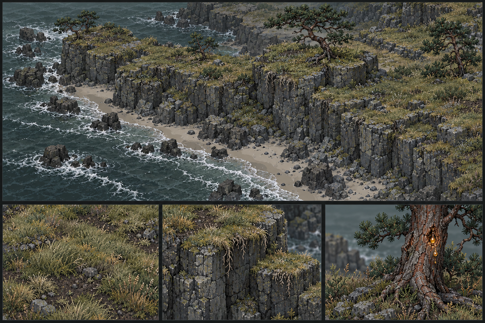

# Rocky Shore — візуальний орієнтир

Користувач затвердив цю панораму 17 жовтня 2026 року як ціль для подальшого розвитку біому Rocky Shore.

Це художній орієнтир, не готовий тайлсет і не вимога повторювати кожну деталь. Зберігати атмосферу, великі форми та композицію, адаптуючи їх до редагованого воксельного світу, напівблоків і піксельного масштабу гри.

## Рельєф

- Різкі скельні уступи з майже плоскими широкими плато зверху; не суцільний гладкий схил або «парабола» від моря вглиб суші.
- Плато утворюють великі природні сходи: кілька широких майже горизонтальних терас на різних висотах, розділених різкими скельними уступами. Зберігати цей ступінчастий силует, а не одне верхнє плато чи дрібні рівномірні сходинки на кожному блоці. Ширина, висота й протяжність терас нерегулярні; це форма рельєфу, а не вимога прохідності кожного уступу.
- Це локальні сходи між незалежними скельними масивами, не вкладені смуги висоти за відстанню від моря. Високе плато може стояти біля самої води та межувати з низьким і середнім; у напрямку вглиб суші висота не мусить зростати. Концепт важливіший за збереження старого алгоритму генерації.
- Значно пологіші пляж і мілина, змінна ширина пляжу вздовж узбережжя.
- Нерегулярні виступи, бухти, розриви скельної стіни та окремі доступні проходи нагору.
- Менші скельні останці й групи каміння на пляжі та в найближчій до берега частині океану.
- Спочатку великі форми, потім уступи й останці, лише потім дрібний шум і декор.

## Атмосфера та матеріали

- Холодний, похмурий, обвітрений морський берег; приглушена палітра, без яскравої соковитої зелені.
- Сірий тріщинуватий камінь, стриманий бежевий пісок, темне сіро-зелене море з прибоєм.
- Низький сіро-оливковий дерен, сухі солом'яні кінчики, прогалини землі й каменю.
- Нерівні краї дерну й короткі корінці над скелею; окремі пучки трави доповнюють базовий матеріал, а не замінюють його.
- Рідкі обвітрені сосни на плато: викривлені стовбури, нерівні розріджені крони, коріння в тріщинах; не густий ялиновий ліс.

## Прогресія

Сосни мають давати гравцю смолу для факелів на початку прогресії. Доступні бурштинові напливи на нижній частині стовбура — потенційний візуальний сигнал ресурсу, без обов'язкового магічного світіння.

## Застосування

Звіряти з цим орієнтиром наступні зміни генератора, трави, сосен і прибережних деталей. Деталізацію панорами спрощувати до читабельних піксельних кластерів гри. Документ фіксує напрям, а не стверджує, що перелічені механіки вже реалізовано.
